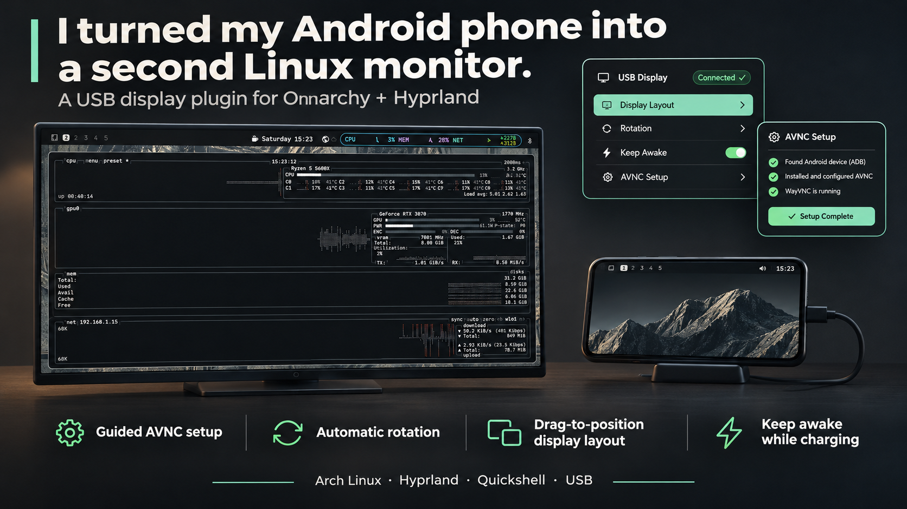

# Omarchy USB Phone Display

Turn your Android phone into an extended Hyprland monitor over USB with AVNC.
Toggle it from your Omarchy bar, rotate the phone, and drag its display into place.
The widget follows your active theme.

**Left-click:** start/stop · **Right-click:** setup and display controls.

## Install

Requires Omarchy’s Quickshell shell, Hyprland, an Android phone, and a USB data cable.
Install the Linux dependencies, then the plugin:

```bash
omarchy pkg add wayvnc android-tools jq iproute2 util-linux openssl
omarchy plugin add https://github.com/AhmedAbdelhady24/omarchy-phone-display --enable
```

## Connect your phone

1. **Install [AVNC](https://f-droid.org/packages/com.gaurav.avnc/)** (`com.gaurav.avnc`) on your phone and open it once.
2. Enable **USB debugging**, connect the cable, and accept Android’s authorization prompt.
3. Right-click the bar widget → **Setup**. Follow the checks and [AVNC profile settings](docs/guide.md#avnc-settings).
4. In **Display**, choose **Phone native resolution**, **Follow phone**, and **60 Hz**. Drag the phone to a monitor edge and press **Start**.
5. Verify and accept AVNC’s [server certificate](docs/guide.md#first-connection) on the first connection after desktop login. Passwords are supplied automatically.

**Keep screen on while charging** changes a persistent Android preference.
Switch it off in Setup to restore normal charging sleep; stopping the display leaves it enabled.

## See it in action


[Setup screenshot](docs/media/setup.png) · [Display controls](docs/media/display-controls.png) · [Theme accents](docs/media/theme-blue.png)

The banner is ChatGPT-generated artwork. The walkthrough shows actual plugin QML
rendered in an isolated preview.

## More details

[Full setup guide](docs/guide.md) · [Rotation and screen fit](docs/guide.md#rotation-screen-fit-and-placement) · [CLI and recovery](docs/guide.md#backend-and-recovery) · [Validation](docs/validation.md)

Streaming requires encrypted authentication. Always stop through the widget:
removing its output externally can briefly share another monitor before cleanup.
See the guide for [security boundaries and limitations](docs/guide.md#backend-and-recovery).

## Remove

```bash
~/.config/omarchy/plugins/user.phone-display/phone-display.sh stop
omarchy plugin disable user.phone-display
omarchy plugin remove user.phone-display --yes
```

[MIT license](LICENSE) · Tested versions and hardware checks: [validation notes](docs/validation.md).
