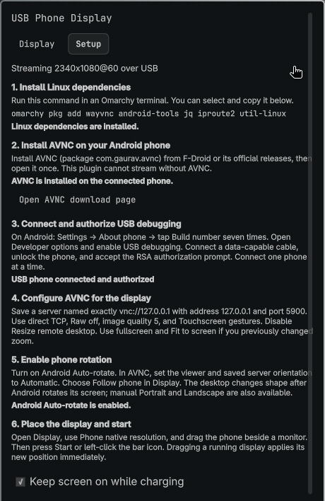
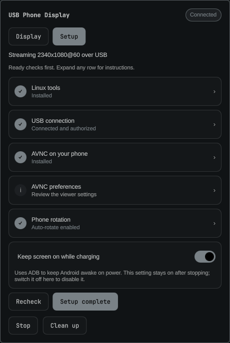
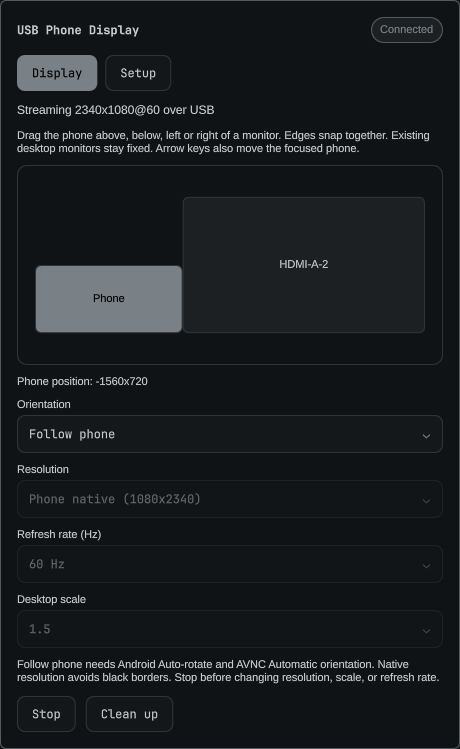

# Omarchy USB Phone Display

Use an Android phone running **AVNC** as an extended Hyprland monitor over USB.
A Quickshell bar widget controls the session, with a built-in setup walkthrough,
phone rotation, and a draggable display layout.
The compact status cards and controls follow Omarchy’s active theme colors,
including live accent changes; expand a setup row only when you need instructions.

- Left-click the bar icon to start or stop; right-click for **Setup** and **Display**.
- **Setup** checks Linux dependencies, USB authorization, and whether AVNC is installed.
- **Phone native resolution** matches the phone's aspect ratio to avoid black borders.
- **Follow phone**, Portrait, and Landscape change the virtual monitor's shape.
- Drag the phone above, below, left, or right of existing monitors. Edges snap together;
  physical monitors stay fixed. Dropping while active applies the position immediately.
- **Keep screen on while charging** explicitly uses ADB to change Android's charging-awake preference.

Tested on Omarchy 4.5.0, Hyprland 0.56.2, Quickshell 0.3.2.r7, WayVNC 0.10.2,
and a Xiaomi Mi 9T with AVNC 3.3.1. Requires Omarchy's Quickshell plugin API,
including `qs.Ui`, `qs.Commons`, and `Commons.Translations`.

## Interface preview



A 10-second walkthrough of the plugin interface: compact setup checks,
expandable instructions, display layout, orientation choices, and theme accents.
The captures render the actual QML components with the connected phone’s state
in an isolated preview. Mint and blue demonstrate live accent changes there;
the installed desktop theme is unchanged. Surrounding desktop content is excluded.

<p>
  
  
</p>

[Expanded instructions](docs/media/setup-instructions.png) ·
[Orientation choices](docs/media/orientation-options.png) ·
[Mint accent](docs/media/theme-mint.png) · [Blue accent](docs/media/theme-blue.png) ·
[Prompt for a LinkedIn/X launch graphic](docs/social-image-prompt.md)

## Install

Install the Linux dependencies in an Omarchy terminal:

```bash
omarchy pkg add wayvnc android-tools jq iproute2 util-linux
```

Install the plugin with Omarchy's native installer:

```bash
omarchy plugin add https://github.com/AhmedAbdelhady24/omarchy-phone-display --enable
```

Omarchy validates the root `manifest.json` and installs to
`~/.config/omarchy/plugins/user.phone-display/`. Native plugin installation
**never runs install hooks or installs dependencies**. Package installation is
therefore an explicit first step, also shown inside Setup.

For a local checkout before publication:

```bash
git clone https://github.com/AhmedAbdelhady24/omarchy-phone-display.git
cd omarchy-phone-display
bash install.sh
```

The optional local-copy installer backs up `shell.json` before enabling the widget
and refuses to overwrite an existing plugin folder. Use native `omarchy plugin
update user.phone-display` for repositories installed through Omarchy.

## First connection

1. **Install AVNC on the phone**: [F-Droid](https://f-droid.org/packages/com.gaurav.avnc/)
   or [official releases](https://github.com/gujjwal00/avnc/releases). Its package
   must be `com.gaurav.avnc`. Open it once.
2. Enable Android Developer options by tapping **Build number** seven times.
   Enable **USB debugging**, connect a data-capable USB cable, unlock the phone,
   and accept its RSA authorization prompt. Connect one phone at a time.
3. Right-click the widget and open **Setup**. If the authorized phone lacks AVNC,
   it explicitly says **AVNC is not installed** and disables Start. Install AVNC
   and press **Recheck**; the check does not install an APK or alter the phone.
4. Configure the AVNC profile as described below. Enable Android **Auto-rotate**
   and set AVNC's viewer and server orientation to **Automatic**.
5. In **Display**, select **Phone native resolution**, **Follow phone**, and 60 Hz.
   Drag the phone rectangle to the desired monitor edge. Press **Start**.
6. Accept any Hyprland capture/input permission prompts. Move a window to the
   new monitor using your normal Hyprland workspace controls.

Wakeup cannot bypass Android's secure lock screen. Wireless ADB and emulators
are excluded. If multiple USB phones are attached, export `ANDROID_SERIAL` in
Quickshell's environment to select one; a terminal-only export affects CLI use.

## Rotation, screen fit, and placement

Follow phone reads Android's current display orientation over ADB about every
2 seconds while streaming, then changes the monitor dimensions without restarting
WayVNC. A 1080×2340 phone receives 2340×1080 in landscape. Android rotation lock
or a fixed AVNC orientation prevents physical rotation from changing that reading;
Setup reports Android's rotation-lock status. Manual Portrait and Landscape are
always available. No global Android rotation setting is changed automatically.

If you previously adjusted AVNC's zoom, use its Fit to screen control. A portrait
remote framebuffer viewed in landscape will have black bars or be cropped; native
resolution plus matching orientation avoids that mismatch. App insets, Android
navigation UI, split-screen, and unusual device ROMs can still affect the viewport.

The layout map moves **the phone output** relative to existing monitors in logical
coordinates. Dragging snaps to an adjacent non-overlapping edge. Arrow keys on the
focused phone rectangle are an alternative. Surrounding controls follow the shell's
language; the physical monitor map retains real left/right coordinates.

Position and orientation can change while active. Stop before changing resolution,
scale, or refresh rate. Desktop scale changes readability, not framebuffer bandwidth.
A live monitor size change may cause windows on that monitor to reflow.
When upgrading from 1.0, restart the shell once with `omarchy restart shell` if
it retains the previous popup: this release introduces a shared QML module.

## Keep screen on while charging

The Setup checkbox is on by default for sessions started from the widget:

```bash
adb -s SERIAL shell svc power stayon true
```

This is an Android preference that persists after the session stops. Unchecking
it explicitly executes `svc power stayon false`. You can still lock the phone
manually. The plugin does not alter Android's general screen timeout or rotation
lock. Standalone CLI starts leave this setting alone unless the seventh start
argument is `true`.

## AVNC settings

| Setting | Starting value |
|---|---|
| Saved server **name** | **`vnc://127.0.0.1`**, exactly, without the port |
| Address / port | `127.0.0.1` / `5900` |
| Connection / security | Direct TCP; Automatic or None for this local server |
| Advanced → Image quality → Raw | Off |
| Advanced → Image quality | 5 (range 0–9) |
| Gesture style | Touchscreen for absolute pointer placement |
| Server and viewer orientation | Automatic; enable Android Auto-rotate |
| Resize remote desktop | Off; the plugin owns monitor geometry |
| Viewer | Fullscreen, Fit to screen, Normal view mode |

The plain launch URI selects a saved profile by its **name**, not by matching its
address and port. Keep the exact name above so intent launches reuse your settings.
See AVNC's [intent handler](https://github.com/gujjwal00/avnc/blob/master/app/src/main/java/com/gaurav/avnc/ui/vnc/IntentReceiverActivity.kt)
and [URI parser](https://github.com/gujjwal00/avnc/blob/master/app/src/main/java/com/gaurav/avnc/vnc/VncUri.kt).

With Raw off, encoding is negotiated. AVNC exposes no general encoding selector,
independent compression-level control, or effective RGB565 setting. Its native
client uses 24-bit RGB color in four-byte pixels. Raw bypasses framebuffer
compression and disables the quality slider. These details come from
[AVNC's native client](https://github.com/gujjwal00/avnc/blob/master/app/src/main/cpp/native-vnc.cpp)
and [profile model](https://github.com/gujjwal00/avnc/blob/master/app/src/main/java/com/gaurav/avnc/model/ServerProfile.kt).

USB does not guarantee zero latency or stable 60 fps. Full-frame Raw at 1080×2400
and 60 fps needs about **622 MB/s before overhead**; at 720×1280 it needs about
221 MB/s. Use Raw off initially. Try lower resolutions before higher refresh
rates if decoding or USB throughput cannot keep up.

## Backend and recovery

```bash
plugin="$HOME/.config/omarchy/plugins/user.phone-display"
"$plugin/phone-display.sh" start native native right-of 1.5 60 auto true
"$plugin/phone-display.sh" configure native native -1560x0 1.5 60 landscape
"$plugin/phone-display.sh" awake on
"$plugin/phone-display.sh" awake off
"$plugin/phone-display.sh" inspect
"$plugin/phone-display.sh" status
"$plugin/phone-display.sh" stop
```

Syntax: `start [width height position scale hz orientation keep-awake]`.
`configure` takes the same geometry options and updates an owned active output.
The original four-argument start interface is preserved; CLI defaults remain
1080×2400, right-of, scale 1.5, 60 Hz, fixed orientation, no charging-awake change.
Use `native native` to detect the device size. Positions accept `left-of`,
`right-of`, or explicit logical `XxY`. Orientation accepts `fixed`, `auto`,
`portrait`, or `landscape`.

The backend creates `PHONE-DISPLAY`, configures a monitor mode, starts only its
own WayVNC on `127.0.0.1:5900`, adds an ADB reverse mapping without rebinding an
existing one, wakes Android, and launches AVNC via the VNC VIEW intent. It supports
legacy `hyprctl keyword monitor` and current Lua `hyprctl eval` configuration.

Stop force-stops AVNC, terminates the owned server, removes its reverse mapping,
and then removes the output. PID/start-time checks prevent killing unrelated
processes. Locks serialize CLI and widget changes. Partial startup failures roll
back; a token-scoped watcher cleans up on USB unplug or server/output loss.
Status is JSON with `active`, `adb_connected`, and `resolution`; active does not
prove that the client is rendering frames or meeting a frame-rate target.

A shared QML singleton owns the operation processes, USB device event subscription,
and runtime-state file watcher. Setup/layout checks run while a popup is open;
phone orientation polling runs only during an active session. Preferences live
in the widget's inline `shell.json` entry. The UI uses Omarchy's shared components,
plain-text diagnostic sinks, English fallback catalogs, and lazy scrollable panels.

Logs and private session state live in
`$XDG_RUNTIME_DIR/omarchy-phone-display-$HYPRLAND_INSTANCE_SIGNATURE/`.
Read `wayvnc.log` and `watch.log` if the popup reports a failure.

**Output-removal caveat:** upstream WayVNC may switch to another output if its
selected output disappears. Always stop through the widget/script; externally
removing the monitor can briefly share another display before cleanup notices.
The unauthenticated loopback listener is reachable by local desktop processes
and phone apps through the reverse mapping. Use a trusted phone/session. This
connection carries pixels and pointer/keyboard events, not audio or multitouch.

## Development and validation

```bash
bash -n phone-display.sh install.sh
omarchy plugin validate .
python3 -m unittest discover -s tests -v
node tests/test_layout.cjs
node tests/test_colors.cjs
```

Python tests fake ADB, Hyprland, and the server using temporary Unix sockets;
they do not alter real desktop outputs or phone settings. Node is needed only
for the layout tests. GitHub Actions runs these checks; QML and hardware behavior
also require validation on an Omarchy session.

Authoring conventions and primary references are recorded in
[docs/omarchy-plugin-guidance.md](docs/omarchy-plugin-guidance.md).
Hardware limits and checks are recorded in [docs/validation.md](docs/validation.md).
Do not commit personal screenshots, USB identifiers, runtime logs, or session state.

## Remove

```bash
~/.config/omarchy/plugins/user.phone-display/phone-display.sh stop
omarchy plugin disable user.phone-display
omarchy plugin remove user.phone-display --yes
```

If desired, turn off charging-awake with the Setup checkbox or `awake off`
before removing the plugin. Stopping alone intentionally preserves that setting.
